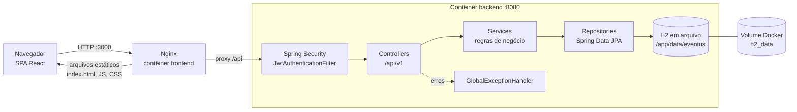
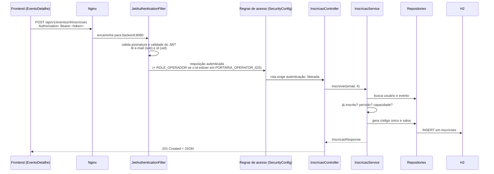
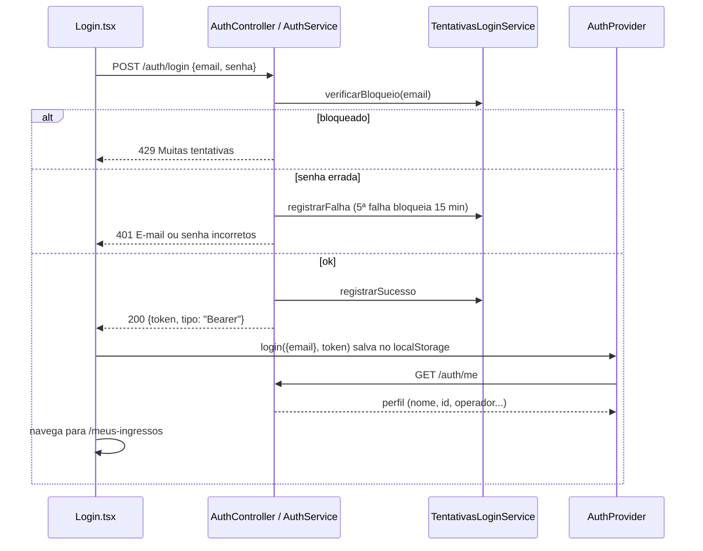

# Parte 2: Arquitetura e Fluxo de Dados

> Estado conferido na branch `dev`, commit `0605458`.

## 1. Visão arquitetural

O Eventus é um **monólito em camadas**, organizado em um **monorepo** com duas aplicações independentes:

- **`backend/`**: API REST em Spring Boot, no padrão em camadas *Controller → Service → Repository*, com DTOs separando o contrato HTTP das entidades JPA.
- **`frontend/`**: SPA (*Single Page Application*) em React, que só conversa com o backend por HTTP/JSON.

Não há microsserviços, filas, cache distribuído nem integrações externas. O banco H2 roda **dentro do processo do backend**, gravando em arquivo. Por isso não existe contêiner de banco.

### 1.1 Camadas do backend

| Camada | Pacote | Responsabilidade | Pode chamar |
|---|---|---|---|
| Segurança | `security`, `config/SecurityConfig` | Ler o token JWT, autenticar a requisição, aplicar regras de acesso por rota e controlar tentativas de login. | `JwtService`, `UsuarioRepository` |
| Controller | `controller` | Receber HTTP, validar o corpo com `@Valid`, obter o e-mail do usuário autenticado e devolver o status HTTP. Não tem regra de negócio. | Services |
| DTO | `dto` | Contratos de entrada (`*Request`, com validações) e de saída (`*Response`, com método `de(...)` que converte a entidade). Garantem, por exemplo, que a senha nunca sai na resposta e que o CPF sai mascarado na portaria. | Entidades (só leitura) |
| Service | `service` | Regras de negócio: idade mínima, unicidade, período e capacidade de inscrição, dono do evento, check-in único. Lança `ApiException` com o status HTTP certo. | Repositories, `Clock`, `PasswordEncoder`, `JwtService` |
| Repository | `repository` | Acesso a dados com Spring Data JPA (métodos derivados do nome e uma consulta JPQL para a portaria). | Banco |
| Model | `model` | Entidades JPA: `Usuario`, `Endereco` (embutido), `Evento`, `Inscricao` e `Dependente`. | — |
| Exceções | `exception` | `ApiException` e `GlobalExceptionHandler`, que converte qualquer erro no formato único `ErroResponse`. | — |

Duas decisões que atravessam as camadas:

- **Relógio injetado (`Clock`)**: `AuthService`, `InscricaoService`, `JwtService` e `TentativasLoginService` recebem um `Clock` em vez de chamar `LocalDateTime.now()` direto. Nos testes isso permite simular datas (classe `RelogioMutavel`).
- **Identidade pelo e-mail**: os controllers passam `auth.getName()` (o e-mail do token) para os services, que buscam o usuário no banco. O `id` só é usado para decidir se a pessoa é operadora da portaria.

### 1.2 Camadas do frontend

| Camada | Pasta | Responsabilidade |
|---|---|---|
| Entrada e rotas | `main.tsx`, `App.tsx` | Carrega o Bootstrap e o CSS, monta o `AuthProvider` e define as rotas. |
| Autenticação | `auth/` | Contexto de sessão (`AuthContext`, `AuthProvider`, `useAuth`), guarda de rota (`ProtectedRoute`) e chaves do `localStorage`. |
| Acesso à API | `api/` | Instância do Axios com `baseURL = VITE_API_URL` e interceptor do token; funções por recurso (inscrições, portaria, imagem) e leitura padronizada de erros (`lerErro`). |
| Páginas | `pages/` | Uma tela por rota. Cada página busca os próprios dados com `useEffect` e `AbortController`. |
| Componentes | `components/` | Peças reutilizáveis: layout, barra, menu do usuário, campos de formulário, listas, cartões, mensagens de erro e carregamento. |
| Hooks e utilitários | `hooks/`, `utils/` | Exibição de erros após o foco sair do campo, máscaras, validação, estados (UF), datas e regra de edição do evento. |
| Tipos | `types/` | Interfaces que espelham os DTOs do backend. |

Não há biblioteca de estado global (Redux, Zustand etc.). O único estado global é a sessão, no `AuthContext`. Os demais dados vivem no estado local de cada página.

---

## 2. Diagrama de arquitetura



Em desenvolvimento sem Docker, o papel do Nginx é feito pelo servidor do Vite: o navegador acessa `http://localhost:5173` e o Vite encaminha `/api` para `http://localhost:8080` (`vite.config.ts`).

Como o frontend e a API ficam na mesma origem (pelo proxy do Nginx ou do Vite), **não há configuração de CORS** no backend.

---

## 3. Ciclo de vida de uma requisição

O exemplo abaixo é a inscrição em um evento, que passa por todas as camadas.



### 3.1 Passo a passo

1. **Frontend.** A função `criarInscricao` usa a instância `http` do Axios. O interceptor em `api/http.ts` lê o token do `localStorage` (chave `eventus.token`) e adiciona `Authorization: Bearer <token>`.
2. **Proxy.** O Nginx recebe `/api/...` e repassa para `http://backend:8080` dentro da rede `eventus-network`.
3. **Filtro JWT** (`JwtAuthenticationFilter`, executado uma vez por requisição, antes do filtro de usuário e senha do Spring):
   - Sem cabeçalho ou com token inválido/expirado, a requisição segue **anônima**. O filtro não responde erro; quem decide é a regra de acesso.
   - Com token válido, extrai o e-mail (`sub`) e o id (`uid`). Se o token não tiver `uid`, busca o id pelo e-mail.
   - Consulta `PortariaOperadores`: se o id estiver na lista, adiciona a autoridade `ROLE_OPERADOR`.
   - Grava a autenticação no `SecurityContextHolder`.
4. **Regras de acesso** (`SecurityConfig`), sem sessão (`STATELESS`) e sem CSRF:

   | Rota | Acesso |
   |---|---|
   | `/api/v1/test`, `/api/v1/auth/cadastro`, `/api/v1/auth/login` | Público |
   | `GET /api/v1/eventos`, `GET /api/v1/eventos/*`, `GET /api/v1/eventos/*/imagem` | Público |
   | `/api/v1/portaria/**` | `ROLE_OPERADOR` |
   | `/v3/api-docs/**`, `/swagger-ui/**`, `/swagger-ui.html` | Público (só respondem com o perfil `dev`) |
   | Qualquer outra rota | Usuário autenticado |

   Se a regra falhar, o próprio `SecurityConfig` escreve o erro em JSON: `401` ("Autenticação necessária") ou `403` ("Acesso negado").
5. **Controller.** O Spring converte o JSON no DTO e aplica `@Valid`. Se algum campo falhar, o `GlobalExceptionHandler` responde `400` com o mapa `campos`. O controller pega o e-mail com `auth.getName()` e chama o service.
6. **Service.** Aplica as regras de negócio. Os métodos de inscrição e portaria são `@Transactional`. Qualquer violação lança `ApiException` com o status adequado (`404`, `409`, `403`, `400`).
7. **Repository e banco.** O Spring Data JPA gera o SQL. O H2 roda em modo PostgreSQL, e o esquema é mantido pelo Hibernate (`ddl-auto=update`).
8. **Resposta.** O service converte a entidade em `*Response` (`InscricaoResponse.de(...)`) e o Jackson serializa em JSON. O status vem de `@ResponseStatus` (por exemplo `201` na criação).
9. **Erros.** `GlobalExceptionHandler` transforma exceções em `ErroResponse`:

   | Exceção | Status | Mensagem |
   |---|---|---|
   | `ApiException` | o definido no service | a do service |
   | `MethodArgumentNotValidException` | 400 | "Dados inválidos" + `campos` |
   | JSON malformado, tipo errado no parâmetro, multipart inválido | 400 | "Requisição inválida" |
   | `MaxUploadSizeExceededException` | 413 | "A imagem deve ter no máximo 2 MB." |
   | `DataIntegrityViolationException` | 409 | "E-mail ou CPF já cadastrado" |
   | `AuthenticationException` / `AccessDeniedException` | 401 / 403 | — |
   | `NoResourceFoundException` | 404 | "Recurso não encontrado" |
   | Qualquer outra | 500 | "Erro interno do servidor" |

   > Observação: o tratamento de `DataIntegrityViolationException` sempre devolve a mensagem de e-mail ou CPF duplicado, mesmo que a violação venha de outra restrição (por exemplo, a restrição única de inscrição por usuário e evento).

10. **Frontend recebe.** `lerErro()` extrai `status`, `mensagem` e `campos`. As páginas mostram a mensagem com `ErrorMessage` e, nos formulários, os erros por campo. Se `GET /auth/me` responder `401`, o `AuthProvider` faz logout.

### 3.2 Fluxo de login e sessão



No `localStorage` ficam só o token e o e-mail. Nome, id e a flag `operador` chegam com `GET /auth/me` e ficam em memória. Por isso, logo após recarregar a página, existe um instante em que o botão Editar e o link Portaria ainda não aparecem.

---

## 4. Estrutura de diretórios

```text
Eventus/
├── .env.example                 # Modelo das variáveis usadas pelo Docker Compose
├── .gitattributes
├── .gitignore                   # Ignora .env, data/ do H2, target/ etc. (node_modules: ver frontend/.gitignore)
├── .github/workflows/
│   ├── ci.yml                   # Build e testes do backend; lint e build do frontend
│   └── branch-name.yml          # Valida o padrão de nome das branches
├── docker-compose.yml           # Serviços backend (8080) e frontend (3000), rede e volume h2_data
├── README.md
├── docs/
│   ├── anexos/DER-Eventus.svg   # Diagrama de dados planejado (tem tabelas que o código não tem)
│   ├── 10-servicos.md           # Portas, URLs e comandos do Docker
│   ├── 06-banco-de-dados.md     # ADR: H2 em dev, PostgreSQL em produção
│   ├── 07-regras-de-negocio.md  # Regras RN001–RN028 frente ao briefing
│   ├── 08-plano-de-testes.md    # Plano de testes
│   └── 09-relatorio-e-evidencias.md # Relatório de evidências de QA
│
├── backend/
│   ├── Dockerfile               # Build com JDK 21, execução com JRE 21 como usuário "spring"
│   ├── pom.xml                  # Dependências e plugins Maven
│   ├── mvnw, mvnw.cmd, .mvn/    # Maven Wrapper
│   └── src/
│       ├── main/java/com/eventus/eventus/
│       │   ├── EventusApplication.java   # Classe principal; fixa locale pt-BR e fuso America/Sao_Paulo
│       │   ├── config/
│       │   │   ├── SecurityConfig.java   # Cadeia de filtros, regras por rota, BCrypt, Clock, erros 401/403
│       │   │   └── OpenApiConfig.java    # Metadados do Swagger e esquema bearerAuth
│       │   ├── security/
│       │   │   ├── JwtService.java              # Gera e valida tokens (sub = e-mail, uid = id)
│       │   │   ├── JwtAuthenticationFilter.java # Lê o Bearer e autentica a requisição
│       │   │   ├── PortariaOperadores.java      # Lista de IDs vinda de PORTARIA_OPERATOR_IDS
│       │   │   └── TentativasLoginService.java  # 5 falhas = bloqueio de 15 min, em memória
│       │   ├── controller/
│       │   │   ├── AuthController.java       # /auth: cadastro, login, me, senha
│       │   │   ├── EventoController.java     # /eventos: CRUD parcial e imagem
│       │   │   ├── InscricaoController.java  # inscrever e minhas inscrições
│       │   │   ├── PortariaController.java   # busca e check-in
│       │   │   ├── DependenteController.java # cadastro e lista de dependentes
│       │   │   └── TestController.java       # health check
│       │   ├── service/
│       │   │   ├── AuthService.java       # Cadastro, login, perfil, senha, idade mínima
│       │   │   ├── EventoService.java     # Criação, edição pelo criador, imagem
│       │   │   ├── InscricaoService.java  # Período, capacidade, duplicidade, código
│       │   │   ├── PortariaService.java   # Busca e check-in único
│       │   │   └── DependenteService.java
│       │   ├── repository/       # Interfaces Spring Data JPA (Usuario, Evento, Inscricao, Dependente)
│       │   ├── model/            # Entidades JPA: Usuario, Endereco, Evento, Inscricao, Dependente
│       │   ├── dto/              # Records de requisição e resposta
│       │   └── exception/        # ApiException, ErroResponse, GlobalExceptionHandler
│       ├── main/resources/
│       │   ├── application.properties      # H2 em arquivo, JWT, operadores, limite de upload
│       │   └── application-dev.properties  # Liga o Swagger
│       └── test/
│           ├── java/com/eventus/eventus/
│           │   ├── ApiFluxoTest.java, RegressaoApiTest.java  # Testes de integração (MockMvc)
│           │   ├── EventusApplicationTests.java              # Sobe o contexto
│           │   ├── RelogioMutavel.java                       # Clock ajustável para testes
│           │   └── service/                                  # Testes unitários dos services
│           └── resources/application-test.properties         # H2 em memória, segredo e operador de teste
│
└── frontend/
    ├── Dockerfile                # Build com Node 20, publicação com Nginx
    ├── nginx.conf                # SPA (fallback para index.html) e proxy /api
    ├── vite.config.ts            # Proxy /api → localhost:8080 no modo dev
    ├── eslint.config.js, tsconfig*.json, package.json, package-lock.json
    ├── index.html, public/favicon.svg
    └── src/
        ├── main.tsx, App.tsx, index.css   # Entrada, rotas e tema visual
        ├── api/        # http.ts (Axios + token), erros.ts, inscricoes.ts, portaria.ts, imagem.ts
        ├── auth/       # AuthContext, AuthProvider, useAuth, ProtectedRoute, storage
        ├── pages/      # Home, Login, Cadastro, EventoDetalhe, NovoEvento, EventoEditar,
        │               # MeusIngressos, Painel, Portaria, NaoEncontrada
        ├── components/ # Layout, Navbar, MenuUsuario, Campo, CampoSelect, FormularioEvento,
        │               # DadosPessoais, ListaEventos, CardIngresso, LinhaPortaria,
        │               # IndicadorApi, ErrorMessage, Loading, EmptyState, IconeClipe
        ├── hooks/      # useErrosVisiveis
        ├── types/      # evento, inscricao, portaria, usuario
        └── utils/      # mascaras, estados, eventos, cpf, datas
```

### 4.1 Rotas do frontend

| Rota | Página | Acesso |
|---|---|---|
| `/` | `Home` (lista de eventos e indicador da API) | Público |
| `/login` | `Login` | Público |
| `/cadastro` | `Cadastro` | Público |
| `/eventos/:id` | `EventoDetalhe` | Público (inscrição exige login) |
| `/eventos/novo` | `NovoEvento` | Logado |
| `/eventos/:id/editar` | `EventoEditar` | Logado; redireciona quem não é o criador |
| `/meus-ingressos` | `MeusIngressos` | Logado |
| `/painel` | `Painel` (abas Dependentes, Dados pessoais e Segurança) | Logado |
| `/portaria` | `Portaria` | Logado; a API só responde para operadores |
| `*` | `NaoEncontrada` | Público |

As rotas "Logado" ficam dentro de `ProtectedRoute`, que manda para `/login` quem não tem sessão.

### 4.2 Pontos de atenção da arquitetura

- **Banco de produção.** A ADR 0001 prevê PostgreSQL em produção, mas o projeto só tem H2. Em Docker, os dados ficam no volume `h2_data`.
- **Perfil `dev`.** O Docker Compose não ativa o perfil `dev`, então o Swagger fica desligado nos contêineres. Para usá-lo, é preciso rodar o backend com `SPRING_PROFILES_ACTIVE=dev`.
- **Estado em memória.** O bloqueio de login fica em um `HashMap` dentro do processo. Funciona com uma instância só e é perdido ao reiniciar.
- **Imagem no banco.** A capa do evento é gravada como BLOB na tabela `eventos`. Simplifica a implantação, mas aumenta o tamanho do banco.
- **DER divergente.** O diagrama em `docs/anexos/` descreve tabelas (`CATEGORIA`, `CHECKIN`, `HISTORICO_ALTERACAO`, `EVENTO_ACESSO`) que não existem nas entidades. O modelo real será documentado na Parte 3.
