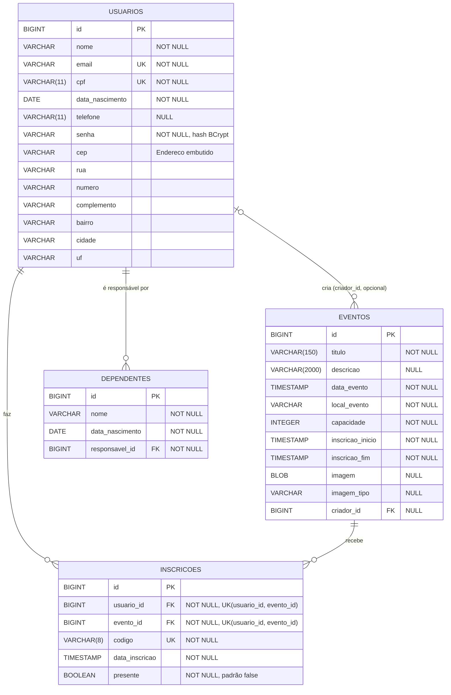

# Parte 3: Domínio e Dados

> Estado conferido na branch `docs/documentacao-tecnica`. Fontes: `backend/src/main/java/com/eventus/eventus/model`, `repository`, `service`, `dto` e `security`.

## 1. Visão geral do modelo

O domínio tem **quatro tabelas** e **um tipo embutido**:

| Entidade | Tabela | Papel |
|---|---|---|
| `Usuario` | `usuarios` | Conta de acesso. Quem se inscreve em eventos, cria eventos e, se o id estiver em `PORTARIA_OPERATOR_IDS`, opera a portaria. |
| `Endereco` | (colunas de `usuarios`) | `@Embeddable`. Não tem tabela nem id próprio. |
| `Evento` | `eventos` | Evento com período de inscrição, capacidade e imagem de capa opcional. |
| `Inscricao` | `inscricoes` | Vínculo entre um usuário e um evento, com código de credencial e a marcação de presença. |
| `Dependente` | `dependentes` | Pessoa cadastrada por um usuário responsável. |

Pontos gerais:

- O esquema é criado pelo Hibernate (`spring.jpa.hibernate.ddl-auto=update` em `application.properties`). **Não há scripts de migração** (Flyway ou Liquibase) nem `schema.sql`.
- Todas as chaves primárias são `Long` com `GenerationType.IDENTITY`.
- Nenhum relacionamento é mapeado no lado "um" (não há `@OneToMany`), e não existe `cascade` nem `orphanRemoval`. Todas as associações são `@ManyToOne` com `FetchType.LAZY`.
- **Papéis não ficam no banco.** Não há coluna de perfil nem tabela de papéis. "Operador" é decidido em tempo de execução pela lista de ids da propriedade `app.portaria.operator-ids` (`PortariaOperadores`). "Organizador" é simplesmente o `criador` de um evento.
- Os nomes das colunas sem `@Column(name = ...)` seguem a estratégia padrão do Spring Boot (camelCase vira snake_case, por exemplo `dataNascimento` → `data_nascimento`).

---

## 2. Diagrama entidade-relacionamento

### 2.1 Cardinalidades

| Relação | Lado JPA | Cardinalidade | Obrigatória? |
|---|---|---|---|
| `Inscricao.usuario` → `Usuario` | `@ManyToOne(optional = false)`, `usuario_id NOT NULL` | N inscrições para 1 usuário | Sim |
| `Inscricao.evento` → `Evento` | `@ManyToOne(optional = false)`, `evento_id NOT NULL` | N inscrições para 1 evento | Sim |
| `Evento.criador` → `Usuario` | `@ManyToOne`, `criador_id` sem `nullable = false` | N eventos para 0 ou 1 usuário | **Não** (a coluna aceita nulo) |
| `Dependente.responsavel` → `Usuario` | `@ManyToOne(optional = false)`, `responsavel_id NOT NULL` | N dependentes para 1 usuário | Sim |
| `Usuario` × `Evento` via `Inscricao` | restrição única `(usuario_id, evento_id)` | N:N, no máximo uma inscrição por par | — |

> **Dependente não se liga a evento nem a inscrição.** O cadastro existe, mas nenhum outro ponto do sistema usa os dependentes. Ver seção 5.

---

## 3. Dicionário de dados

Legenda: **Banco** é o que a anotação JPA gera; **Entrada** é a validação do DTO (`jakarta.validation`) ou o tratamento feito no service antes de gravar. Quando a coluna não define `length`, o Hibernate usa o padrão de `VARCHAR(255)`.

### 3.1 `Usuario` (tabela `usuarios`)

Classe: `model/Usuario.java`. Entrada: `dto/CadastroRequest.java` e `dto/AtualizarPerfilRequest.java`.

| Campo | Coluna | Tipo Java | Banco | Entrada | Observações |
|---|---|---|---|---|---|
| `id` | `id` | `Long` | PK, identity | — | |
| `nome` | `nome` | `String` | `NOT NULL`, 255 | `@NotBlank`, `@Size(max = 120)` | Gravado com `trim()`. |
| `email` | `email` | `String` | `NOT NULL`, `UNIQUE`, 255 | `@NotBlank`, `@Email`, `@Size(max = 150)` | Gravado com `trim().toLowerCase()`. **Não pode ser alterado** (fica fora de `AtualizarPerfilRequest`). |
| `cpf` | `cpf` | `String` | `NOT NULL`, `UNIQUE`, 11 | `@NotBlank`, `@Pattern("\d{3}\.?\d{3}\.?\d{3}-?\d{2}")` | Pontuação removida antes de gravar. **Os dígitos verificadores não são validados**, só o formato. Não pode ser alterado. |
| `dataNascimento` | `data_nascimento` | `LocalDate` | `NOT NULL` | `@NotNull`, `@Past` | Idade mínima de 18 anos no service (seção 4.4). |
| `telefone` | `telefone` | `String` | nulo, 11 | `@Pattern("\d{10,11}")`, opcional | Só dígitos. |
| `senha` | `senha` | `String` | `NOT NULL`, 255 | `@NotBlank`, `@Size(min = 8, max = 72)` | Gravado o hash BCrypt (`PasswordEncoder`). Nunca sai nas respostas. |
| `endereco` | (embutido) | `Endereco` | ver 3.2 | `@NotNull @Valid EnderecoDto` | |

### 3.2 `Endereco` (embutido em `usuarios`)

Classe: `model/Endereco.java` (`@Embeddable`). Entrada: `dto/EnderecoDto.java`.

| Campo | Coluna | Tipo Java | Banco | Entrada | Observações |
|---|---|---|---|---|---|
| `cep` | `cep` | `String` | nulo, 255 | `@NotBlank`, `@Pattern("\d{5}-?\d{3}")` | Gravado só com dígitos. |
| `rua` | `rua` | `String` | nulo, 255 | `@NotBlank`, `@Size(max = 150)` | `trim()` |
| `numero` | `numero` | `String` | nulo, 255 | `@NotBlank`, `@Size(max = 20)` | `trim()` |
| `complemento` | `complemento` | `String` | nulo, 255 | `@Size(max = 100)`, opcional | Texto em branco vira `null`. |
| `bairro` | `bairro` | `String` | nulo, 255 | `@NotBlank`, `@Size(max = 100)` | `trim()` |
| `cidade` | `cidade` | `String` | nulo, 255 | `@NotBlank`, `@Size(max = 100)` | `trim()` |
| `uf` | `uf` | `String` | nulo, 255 | `@NotBlank`, `@Pattern("[A-Za-z]{2}")` | Gravado em maiúsculas. Não é conferido contra a lista de UFs no backend. |

> As colunas do endereço **aceitam nulo no banco**, porque `Endereco` não tem `@Column(nullable = false)`. A obrigatoriedade existe só na validação do DTO.

### 3.3 `Evento` (tabela `eventos`)

Classe: `model/Evento.java`. Entrada: `dto/EventoRequest.java` e upload multipart em `EventoService.salvarImagem`.

| Campo | Coluna | Tipo Java | Banco | Entrada | Observações |
|---|---|---|---|---|---|
| `id` | `id` | `Long` | PK, identity | — | |
| `titulo` | `titulo` | `String` | `NOT NULL`, 150 | `@NotBlank`, `@Size(max = 150)` | `trim()` |
| `descricao` | `descricao` | `String` | nulo, 2000 | `@Size(max = 2000)`, opcional | |
| `data` | `data_evento` | `LocalDateTime` | `NOT NULL` | `@NotNull` | Data e hora do evento. Ver seção 4.7: não é comparada com nenhuma outra data. |
| `local` | `local_evento` | `String` | `NOT NULL`, 255 | `@NotBlank`, `@Size(max = 255)` | `trim()` |
| `capacidade` | `capacidade` | `Integer` | `NOT NULL` | `@NotNull`, `@Min(1)` | Sem limite máximo. |
| `inscricaoInicio` | `inscricao_inicio` | `LocalDateTime` | `NOT NULL` | `@NotNull` | |
| `inscricaoFim` | `inscricao_fim` | `LocalDateTime` | `NOT NULL` | `@NotNull` | Precisa ser depois de `inscricaoInicio`. |
| `imagem` | `imagem` | `byte[]` | nulo, `@Lob`, `binary large object` | multipart, até 2 MB | JPG, PNG ou WEBP. Só muda pelo endpoint de imagem. |
| `imagemTipo` | `imagem_tipo` | `String` | nulo, 255 | — | Content-Type informado pelo cliente no upload (por exemplo `image/png`). |
| `criador` | `criador_id` | `Usuario` | FK para `usuarios.id`, **nulo permitido** | — | Preenchido com o usuário do token em `EventoService.criar`. Eventos sem criador não podem ser editados por ninguém. |

### 3.4 `Inscricao` (tabela `inscricoes`)

Classe: `model/Inscricao.java`. Não há DTO de entrada: a inscrição é criada só com o id do evento (na URL) e o usuário do token.

| Campo | Coluna | Tipo Java | Banco | Origem | Observações |
|---|---|---|---|---|---|
| `id` | `id` | `Long` | PK, identity | — | Usado pela portaria para registrar a entrada. |
| `usuario` | `usuario_id` | `Usuario` | FK, `NOT NULL` | usuário do token | Parte da restrição única `(usuario_id, evento_id)`. |
| `evento` | `evento_id` | `Evento` | FK, `NOT NULL` | id da URL | Parte da restrição única `(usuario_id, evento_id)`. |
| `codigo` | `codigo` | `String` | `NOT NULL`, `UNIQUE`, 8 | `InscricaoService.gerarCodigo` | 8 caracteres de `A–Z0–9`, sorteados com `SecureRandom`; sorteia de novo se já existir. |
| `dataInscricao` | `data_inscricao` | `LocalDateTime` | `NOT NULL` | `LocalDateTime.now(clock)` | |
| `presente` | `presente` | `boolean` | `NOT NULL`, padrão `false` | portaria | Vira `true` no check-in. **Não há data/hora nem operador do check-in.** |

> Não existe campo de **status** (confirmada, cancelada) nem endpoint de cancelamento. Toda inscrição gravada conta como ativa.

### 3.5 `Dependente` (tabela `dependentes`)

Classe: `model/Dependente.java`. Entrada: `dto/DependenteRequest.java`.

| Campo | Coluna | Tipo Java | Banco | Entrada | Observações |
|---|---|---|---|---|---|
| `id` | `id` | `Long` | PK, identity | — | |
| `nome` | `nome` | `String` | `NOT NULL`, 255 | `@NotBlank`, `@Size(max = 120)` | `trim()` |
| `dataNascimento` | `data_nascimento` | `LocalDate` | `NOT NULL` | `@NotNull`, `@Past` | Sem regra de idade. |
| `responsavel` | `responsavel_id` | `Usuario` | FK, `NOT NULL` | usuário do token | |

### 3.6 Consultas dos repositórios

| Repositório | Método | Uso |
|---|---|---|
| `UsuarioRepository` | `findByEmail`, `existsByEmail`, `existsByCpf` | Login, identificação pelo token, unicidade no cadastro. |
| `EventoRepository` | `findAllByOrderByDataAsc` | Lista pública de eventos, por data. |
| `InscricaoRepository` | `existsByEventoIdAndUsuarioId`, `countByEventoId`, `existsByCodigo`, `findByUsuarioIdOrderByDataInscricaoDesc` | Regras de inscrição, geração de código e "minhas inscrições". |
| `InscricaoRepository` | `buscarParaPortaria(termo, cpf)` (JPQL) | Busca da portaria por código exato (sem diferenciar maiúsculas), CPF exato ou parte do nome. |
| `InscricaoRepository` | `findByCodigo`, `findByEventoIdAndUsuarioId` | **Declarados e não usados** em `src/main`. |
| `DependenteRepository` | `findByResponsavelIdOrderByNome` | Lista de dependentes do usuário. |

---

## 4. Regras de negócio críticas

| # | Regra | Onde | Status HTTP |
|---|---|---|---|
| 4.1 | Período de inscrição | `InscricaoService.inscrever` | 409 |
| 4.2 | Capacidade | `InscricaoService.inscrever` | 409 |
| 4.3 | Inscrição duplicada | `InscricaoService.inscrever` + restrição única | 409 |
| 4.4 | Idade mínima de 18 anos | `AuthService.validarIdade` | 400 |
| 4.5 | E-mail e CPF únicos | `AuthService.cadastrar` + `@Column(unique)` | 409 |
| 4.6 | Só o criador edita o evento | `EventoService.validarCriador` | 403 |
| 4.7 | Datas do evento | `EventoService.validarDatas` | 400 |
| 4.8 | Check-in único | `PortariaService.registrarEntrada` | 409 |
| 4.9 | Bloqueio de login por tentativas | `TentativasLoginService` | 429 |

### 4.1 Período de inscrição

- **Onde:** `InscricaoService.inscrever` (linhas 50–53).
- **Regra:** com `agora = LocalDateTime.now(clock)`, a inscrição é recusada se `agora` for antes de `inscricaoInicio` ou depois de `inscricaoFim`. Os dois limites são inclusivos.
- **Erro:** `409` "Fora do período de inscrição deste evento".
- **Ordem das verificações:** usuário existe → evento existe (`404`) → já inscrito (`409`) → período (`409`) → capacidade (`409`).

### 4.2 Capacidade

- **Onde:** `InscricaoService.inscrever` (linhas 55–57).
- **Regra:** recusa se `inscricoes.countByEventoId(eventoId) >= evento.getCapacidade()`. Como não há cancelamento, toda inscrição gravada ocupa vaga.
- **Erro:** `409` "Evento sem vagas disponíveis".
- **Limitação:** o método é `@Transactional`, mas a contagem e o `INSERT` não usam bloqueio (nem `@Lock` nem `SELECT ... FOR UPDATE`) e não há restrição no banco. Duas requisições simultâneas na última vaga podem passar as duas. Será tratado na Parte 6.

### 4.3 Inscrição duplicada

- **Onde:** `InscricaoService.inscrever` (linhas 46–48), com `existsByEventoIdAndUsuarioId`.
- **Garantia no banco:** `@UniqueConstraint(columnNames = {"usuario_id", "evento_id"})` em `Inscricao`.
- **Erro:** `409` "Você já está inscrito neste evento".
- **Observação:** se duas requisições iguais chegarem juntas, a segunda é barrada pela restrição única. O `GlobalExceptionHandler` converte a `DataIntegrityViolationException` em `409` com a mensagem **"E-mail ou CPF já cadastrado"**, que não corresponde ao caso.

### 4.4 Idade mínima

- **Onde:** `AuthService.validarIdade` (linhas 109–113), chamado em `cadastrar` e em `atualizarPerfil`. Constante `AuthService.IDADE_MINIMA = 18`.
- **Regra:** `Period.between(dataNascimento, LocalDate.now(clock)).getYears() < 18` recusa. Antes disso, o DTO exige `@Past`.
- **Erro:** `400` "É necessário ter pelo menos 18 anos".
- **Não se aplica a dependentes:** `DependenteService.criar` não verifica idade.

### 4.5 Unicidade de e-mail e CPF

- **Onde:** `AuthService.cadastrar` (linhas 48–52). O e-mail é normalizado (`trim().toLowerCase()`) e o CPF fica só com dígitos antes da consulta `existsByEmail || existsByCpf`.
- **Garantia no banco:** `@Column(unique = true)` em `Usuario.email` e `Usuario.cpf`.
- **Erro:** `409` "E-mail ou CPF já cadastrado". A mensagem é a mesma para os dois casos, e a corrida entre duas requisições cai no `GlobalExceptionHandler.conflito`, que devolve o mesmo texto.
- E-mail e CPF não podem ser alterados depois do cadastro (`AtualizarPerfilRequest` não tem esses campos).

### 4.6 Dono do evento

- **Onde:** `EventoService.validarCriador` (linhas 105–109), chamado em `atualizar` e em `salvarImagem`.
- **Regra:** só passa se `evento.getCriador()` não for nulo e o e-mail do criador for igual ao e-mail do token.
- **Erro:** `403` "Somente o criador pode editar este evento".
- **Observação:** qualquer usuário autenticado pode **criar** eventos. Não existe papel de organizador. Não há endpoint para excluir evento.

### 4.7 Validação de datas do evento

- **Onde:** `EventoService.validarDatas` (linhas 78–83), chamado em `criar` e em `atualizar`.
- **Regra implementada:** `inscricaoFim` precisa ser estritamente depois de `inscricaoInicio`.
- **Erro:** `400` "O fim da inscrição deve ser depois do início da inscrição".
- **O que não é validado no backend:**
  - `data` (data do evento) em relação ao período de inscrição: um evento pode terminar a inscrição depois de já ter acontecido;
  - `data` ou `inscricaoInicio` no passado;
  - a nova `capacidade` na edição pode ficar menor que o número de inscrições já feitas.

### 4.8 Check-in único

- **Onde:** `PortariaService.registrarEntrada` (linhas 34–43), `@Transactional`.
- **Regra:** se `inscricao.isPresente()` já for `true`, recusa; senão marca `presente = true`.
- **Erros:** `404` "Inscrição não encontrada" e `409` "Entrada já registrada".
- **Limitações:**
  - não grava a data/hora nem o operador do check-in;
  - não confere se o evento é hoje (o check-in pode ser feito em qualquer data);
  - sem bloqueio pessimista ou versão (`@Version`), dois check-ins simultâneos podem passar os dois, mas o efeito no banco é o mesmo (`presente = true`).
- **Acesso:** a rota `/api/v1/portaria/**` exige `ROLE_OPERADOR` (`SecurityConfig`), dado pelo `JwtAuthenticationFilter` quando o id do usuário está em `PortariaOperadores`.

### 4.9 Bloqueio do login por tentativas

- **Onde:** `security/TentativasLoginService.java`, chamado por `AuthService.login` (linhas 95–107).
- **Regra:** contagem por e-mail normalizado. Na 5ª falha seguida (`MAX_FALHAS = 5`), o e-mail fica bloqueado por 15 minutos (`BLOQUEIO`). Um login certo zera a contagem. Quando o bloqueio expira, o estado é removido na próxima tentativa.
- **Erros:** `401` "E-mail ou senha incorretos" (sem dizer qual campo está errado) e `429` "Muitas tentativas de login. Tente novamente em N minuto(s)".
- **Limitações:**
  - o estado fica em um `HashMap` em memória, com os métodos `synchronized`. Perde-se ao reiniciar e não é compartilhado entre instâncias;
  - e-mails que não existem também são contados, e o mapa não tem limpeza das entradas que nunca chegam a bloquear;
  - durante o bloqueio, nem a senha certa entra.

---

## 5. Código morto, trechos incompletos e marcações

Uma busca por `TODO`, `FIXME`, `XXX` e `HACK` em `backend/src` e `frontend/src` **não encontrou nenhuma ocorrência**. Os itens abaixo são trechos sem uso ou incompletos encontrados na leitura:

| Item | Onde | Situação |
|---|---|---|
| `findByCodigo` e `findByEventoIdAndUsuarioId` | `repository/InscricaoRepository.java` | Declarados, sem chamada no código principal. |
| Dependentes | `model/Dependente.java`, `DependenteService` | Só criar e listar. Não há edição, exclusão nem ligação com eventos ou inscrições. |
| `Evento.criador` aceitando nulo | `model/Evento.java` | Evento sem criador fica impossível de editar (`validarCriador` recusa). |
| Status da inscrição | `model/Inscricao.java` | Não existe. Por isso não há cancelamento nem liberação de vaga. |
| Registro do check-in | `model/Inscricao.java` | Só o booleano `presente`. Falta data/hora e operador. |
| Mensagem de `DataIntegrityViolationException` | `exception/GlobalExceptionHandler.java` | Sempre "E-mail ou CPF já cadastrado", mesmo em violação de outra restrição. |
| Validação do CPF | `dto/CadastroRequest.java` | Só formato, sem dígitos verificadores. |

---

## 6. Regras documentadas que não existem no código

Comparação entre `docs/07-regras-de-negocio.md` e o código atual. Serve de base para a Parte 6.

### 6.1 Regras RN001–RN028

| ID | Regra (resumo) | Situação no código |
|---|---|---|
| RN001 | Redirecionar após o login conforme o papel | **Não existe.** `Login.tsx` sempre navega para `/meus-ingressos`. Não há papéis no banco. |
| RN002 | "E-mail ou senha incorretos" sem dizer o campo | Implementada (`AuthService.login`). |
| RN003 | Bloqueio de 15 min após 5 falhas | Implementada (`TentativasLoginService`), só em memória. |
| RN004 | Login só com e-mail verificado | **Não existe.** Não há envio de e-mail nem campo de verificação. |
| RN005 | E-mail e CPF únicos | Implementada (`AuthService.cadastrar` + `UNIQUE`). |
| RN006 | Link de recuperação de senha com validade de 24 h | **Não existe.** Não há recuperação de senha, só a troca com a senha atual. |
| RN007 | Data de nascimento obrigatória no cadastro; o sistema calcula a idade e bloqueia o cadastro de menores de 13 anos sem autorização legal | **Implementada de outro jeito.** A data de nascimento é obrigatória (`@NotNull @Past`), mas o código bloqueia todo cadastro de quem tem **menos de 18 anos** (`AuthService.IDADE_MINIMA = 18`), não de 13, e não existe a exceção por autorização legal. |
| RN008 | Classificação indicativa obrigatória no evento | **Não existe.** `Evento` não tem campo de faixa etária. |
| RN009 | Bloqueio da inscrição por faixa etária | **Não existe.** Depende da RN008. |
| RN010 | Responsável legal para menores | **Não existe.** `Dependente` tem um responsável, mas não se liga a eventos nem a inscrições. |
| RN011 | Rascunho automático do evento no navegador | **Não existe.** O `localStorage` só guarda token e e-mail. |
| RN012 | Inscrições não passam da capacidade | Implementada (`InscricaoService.inscrever`). |
| RN013 | Virada automática de lote | **Não existe** (fora de escopo). |
| RN014 | Máximo de 4 ingressos por CPF no evento | **Não existe.** O código aplica uma inscrição por usuário e evento. |
| RN015 | Reserva de poltrona por 10 min | **Não existe** (fora de escopo). |
| RN016 | Liberação por timeout no checkout | **Não existe** (fora de escopo). |
| RN017 | Última vaga sob concorrência | **Parcial.** Há a verificação de capacidade, sem controle de concorrência (seção 4.2). |
| RN018 | Idempotência do pagamento | **Não existe** (fora de escopo). |
| RN019 | Expiração do PIX | **Não existe** (fora de escopo). |
| RN020 | Voucher após pagamento | **Não existe** como descrita. O código único de inscrição é gerado na inscrição. |
| RN021 | Transferência de titularidade | **Não existe.** |
| RN022 | Reembolso de 80% até 48 h | **Não existe** (fora de escopo). |
| RN023 | Bloqueio de cancelamento fora do prazo | **Não existe.** Não há cancelamento. |
| RN024 | Retenção de taxa no reembolso | **Não existe** (fora de escopo). |
| RN025 | Reembolso integral se o organizador cancelar | **Não existe** (fora de escopo). Não há cancelamento nem exclusão de evento. |
| RN026 | Busca na portaria por CPF ou código | Implementada e ampliada: código, CPF ou parte do nome (`buscarParaPortaria`). Não busca por e-mail, como pede o briefing. |
| RN027 | Avisar e impedir entrada já registrada, com horário | **Parcial.** Impede (`409`), mas não mostra o horário, porque ele não é gravado. |
| RN028 | Inscrição cancelada inativa na portaria | **Não existe.** Não há status de inscrição. |

### 6.2 Regras obrigatórias do briefing (seção 3 de `07-regras-de-negocio.md`)

| # | Regra do briefing | Situação no código |
|---|---|---|
| 1 | Inscrição só no período e com vaga | Implementada (seções 4.1 e 4.2), sem controle de concorrência. |
| 2 | Uma inscrição ativa por e-mail no mesmo evento | Implementada como uma inscrição por **usuário** (seção 4.3). |
| 3 | Cancelamento antes do prazo libera a vaga | **Não existe.** |
| 4 | Check-in só para inscrição confirmada | **Não existe.** Não há status, então toda inscrição aceita check-in. |
| 5 | No máximo um check-in por inscrição | Implementada (seção 4.8). |
| 6 | Check-in registra data/hora e operador | **Não existe.** Só o booleano `presente`. |
| 7 | Evento encerrado não aceita inscrição nem mudança de capacidade sem ação registrada | **Parcial.** A inscrição é barrada pelo fim do período, mas o criador pode editar capacidade e datas a qualquer momento, sem registro. Não há histórico de alterações. |
| 8 | Indicadores derivados dos dados reais | **Não existe.** Não há dashboard nem endpoint de indicadores. |
