# Parte 4: API e Interfaces

> Estado conferido na branch `docs/documentacao-tecnica`. Fontes: `backend/src/main/java/com/eventus/eventus/controller`, `service`, `dto`, `exception`, `config/SecurityConfig.java` e `security/`; `frontend/src/App.tsx`, `api/`, `auth/`, `pages/` e `components/`.

## 1. Convenções da API

| Item | Valor |
|---|---|
| Prefixo | `/api/v1` |
| Formato | JSON (`application/json`), exceto o upload de imagem (`multipart/form-data`) e o download dela (bytes da imagem) |
| Autenticação | `Authorization: Bearer <token>`, com o JWT devolvido por `POST /auth/login` |
| Sessão | Nenhuma (`SessionCreationPolicy.STATELESS`). CSRF desligado. |
| Datas | `LocalDate` como `"AAAA-MM-DD"`; `LocalDateTime` como `"AAAA-MM-DDTHH:MM:SS"`, sem fuso. O fuso do processo é `America/Sao_Paulo` (`EventusApplication.init`). |
| Documentação interativa | Swagger em `/swagger-ui.html` e `/v3/api-docs`, **só com o perfil `dev`** (`application-dev.properties`) |

> Os valores nos exemplos de JSON abaixo são ilustrativos. Os **nomes dos campos** são os dos records em `dto/`.

### 1.1 Níveis de acesso

Definidos em `SecurityConfig.securityFilterChain`:

| Nível | Quem | Como é decidido |
|---|---|---|
| **Público** | Qualquer um, com ou sem token | `permitAll()` |
| **Autenticado** | Quem manda um JWT válido e não expirado | `anyRequest().authenticated()` |
| **Operador** | Autenticado cujo id está em `app.portaria.operator-ids` (`PORTARIA_OPERATOR_IDS`) | `hasRole("OPERADOR")`. O `JwtAuthenticationFilter` adiciona `ROLE_OPERADOR` quando `PortariaOperadores.isOperador(id)` é verdadeiro. |
| **Criador do evento** | Autenticado cujo e-mail é o do `criador` do evento | Não é regra do `SecurityConfig`. É conferido em `EventoService.validarCriador` e devolve `403`. |

Token ausente, malformado, com assinatura errada ou expirado **não gera erro no filtro**: a requisição segue anônima. Em rota protegida, o `authenticationEntryPoint` responde `401`. Autenticado sem o papel exigido recebe `403` do `accessDeniedHandler`.

### 1.2 Formato de erro

Todos os erros usam `ErroResponse` (`exception/ErroResponse.java`). O campo `campos` só aparece em erro de validação. Ele traz uma mensagem por campo (a primeira, se houver mais de uma). Quando o DTO não define `message`, o texto vem do Hibernate Validator e depende do idioma; os do exemplo são ilustrativos.

```json
{
  "timestamp": "2026-11-24T22:10:05.123Z",
  "status": 400,
  "erro": "Bad Request",
  "mensagem": "Dados inválidos",
  "campos": {
    "email": "deve ser um endereço de e-mail bem formado",
    "senha": "A senha deve ter entre 8 e 72 caracteres"
  }
}
```

### 1.3 Erros comuns a vários endpoints

Para não repetir em cada tabela, estes erros valem para todo endpoint onde a condição pode acontecer:

| Status | Mensagem | Quando | Origem |
|---|---|---|---|
| 400 | "Dados inválidos" + `campos` | Falha de `@Valid` no corpo | `GlobalExceptionHandler.validacao` |
| 400 | "Requisição inválida" | JSON malformado, data em formato errado, id da URL que não é número, parte multipart ausente | `GlobalExceptionHandler.requisicaoInvalida` |
| 401 | "Autenticação necessária" | Rota protegida sem token válido | `SecurityConfig` (entry point) |
| 401 | "Usuário do token não existe mais" | Token válido de um usuário que foi apagado do banco | `buscarUsuario` em `AuthService`, `EventoService`, `InscricaoService` e `DependenteService` |
| 403 | "Acesso negado" | Autenticado sem `ROLE_OPERADOR` em `/portaria/**` | `SecurityConfig` (access denied handler) |
| 404 | "Recurso não encontrado" | Rota que não existe | `GlobalExceptionHandler.rotaInexistente` |
| 500 | "Erro interno do servidor" | Qualquer exceção não prevista | `GlobalExceptionHandler.inesperado` |

---

## 2. Resumo dos endpoints

| # | Método | URL | Acesso | Sucesso |
|---|---|---|---|---|
| 3.1 | `POST` | `/api/v1/auth/cadastro` | Público | 201 |
| 3.2 | `POST` | `/api/v1/auth/login` | Público | 200 |
| 3.3 | `GET` | `/api/v1/auth/me` | Autenticado | 200 |
| 3.4 | `PUT` | `/api/v1/auth/me` | Autenticado | 200 |
| 3.5 | `PUT` | `/api/v1/auth/me/senha` | Autenticado | 204 |
| 4.1 | `GET` | `/api/v1/eventos` | Público | 200 |
| 4.2 | `GET` | `/api/v1/eventos/{id}` | Público | 200 |
| 4.3 | `POST` | `/api/v1/eventos` | Autenticado | 201 |
| 4.4 | `PUT` | `/api/v1/eventos/{id}` | Autenticado + criador | 200 |
| 4.5 | `PUT` | `/api/v1/eventos/{id}/imagem` | Autenticado + criador | 200 |
| 4.6 | `GET` | `/api/v1/eventos/{id}/imagem` | Público | 200 |
| 5.1 | `POST` | `/api/v1/eventos/{id}/inscricoes` | Autenticado | 201 |
| 5.2 | `GET` | `/api/v1/inscricoes/minhas` | Autenticado | 200 |
| 6.1 | `GET` | `/api/v1/portaria/busca?q=` | Operador | 200 |
| 6.2 | `POST` | `/api/v1/portaria/inscricoes/{id}/checkin` | Operador | 200 |
| 7.1 | `POST` | `/api/v1/dependentes` | Autenticado | 201 |
| 7.2 | `GET` | `/api/v1/dependentes` | Autenticado | 200 |
| 8.1 | `GET` | `/api/v1/test` | Público | 200 |

Não existem endpoints de `DELETE` nem de cancelamento de inscrição, exclusão de evento, edição ou exclusão de dependente, logout ou recuperação de senha.

---

## 3. Autenticação (`AuthController`, `/api/v1/auth`)

### 3.1 `POST /api/v1/auth/cadastro`

Cria uma conta. **Não** devolve token: o usuário precisa fazer login depois.

- **Acesso:** público.
- **Fluxo:** `AuthController.cadastrar` → `AuthService.cadastrar`.
- **Request** (`CadastroRequest` + `EnderecoDto`):

```json
{
  "nome": "Maria Souza",
  "email": "maria@exemplo.com",
  "telefone": "11987654321",
  "cpf": "123.456.789-09",
  "dataNascimento": "1995-04-10",
  "senha": "senhaSegura123",
  "endereco": {
    "cep": "01310-100",
    "rua": "Avenida Paulista",
    "numero": "1000",
    "complemento": "Apto 12",
    "bairro": "Bela Vista",
    "cidade": "São Paulo",
    "uf": "SP"
  }
}
```

| Campo | Regras |
|---|---|
| `nome` | obrigatório, até 120 |
| `email` | obrigatório, formato de e-mail, até 150. Gravado em minúsculas. |
| `telefone` | opcional, 10 ou 11 dígitos, sem pontuação |
| `cpf` | obrigatório, `000.000.000-00` ou só dígitos. Só o formato é validado. |
| `dataNascimento` | obrigatória, no passado |
| `senha` | obrigatória, 8 a 72 caracteres |
| `endereco` | obrigatório. `cep` (`00000-000` ou 8 dígitos), `rua` (até 150), `numero` (até 20), `bairro` e `cidade` (até 100), `uf` (2 letras) obrigatórios; `complemento` opcional (até 100). |

- **Response `201`** (`UsuarioResponse`):

```json
{
  "id": 7,
  "nome": "Maria Souza",
  "email": "maria@exemplo.com",
  "telefone": "11987654321",
  "cpf": "12345678909",
  "dataNascimento": "1995-04-10",
  "endereco": {
    "cep": "01310100",
    "rua": "Avenida Paulista",
    "numero": "1000",
    "complemento": "Apto 12",
    "bairro": "Bela Vista",
    "cidade": "São Paulo",
    "uf": "SP"
  },
  "operador": false
}
```

- **Erros:**

| Status | Mensagem | Origem |
|---|---|---|
| 400 | "Dados inválidos" + `campos` | validação do DTO |
| 400 | "É necessário ter pelo menos 18 anos" | `AuthService.validarIdade` |
| 409 | "E-mail ou CPF já cadastrado" | `AuthService.cadastrar` ou `DataIntegrityViolationException` |

### 3.2 `POST /api/v1/auth/login`

- **Acesso:** público.
- **Fluxo:** `AuthController.login` → `AuthService.login` → `TentativasLoginService` e `JwtService.gerar`.
- **Request** (`LoginRequest`): `email` e `senha`, os dois `@NotBlank`. O e-mail é comparado depois de `trim().toLowerCase()`.

```json
{ "email": "maria@exemplo.com", "senha": "senhaSegura123" }
```

- **Response `200`** (`TokenResponse`):

```json
{ "token": "eyJhbGciOiJIUzI1NiJ9...", "tipo": "Bearer" }
```

O JWT é assinado com HMAC (`Keys.hmacShaKeyFor(JWT_SECRET)`), tem `sub` = e-mail, a claim `uid` = id do usuário e validade de `app.jwt.expiration-minutes` (60 minutos). A resposta não traz os dados do usuário: o frontend chama `GET /auth/me` em seguida.

- **Erros:**

| Status | Mensagem | Origem |
|---|---|---|
| 400 | "Dados inválidos" + `campos` | campo em branco |
| 401 | "E-mail ou senha incorretos" | e-mail inexistente ou senha errada (conta uma falha) |
| 429 | "Muitas tentativas de login. Tente novamente em N minuto(s)" | 5 falhas seguidas no mesmo e-mail, por 15 minutos (`TentativasLoginService.verificarBloqueio`) |

### 3.3 `GET /api/v1/auth/me`

- **Acesso:** autenticado.
- **Fluxo:** `AuthController.me` → `AuthService.perfil`.
- **Response `200`:** `UsuarioResponse`, igual ao de 3.1. O CPF vem completo, sem máscara, e `operador` indica se o id está em `PORTARIA_OPERATOR_IDS`.
- **Erros:** `401` "Autenticação necessária" ou "Usuário do token não existe mais".

> `AuthController.emailLogado` repete a verificação de autenticação que o `SecurityConfig` já faz para `/auth/me`. É uma proteção redundante.

### 3.4 `PUT /api/v1/auth/me`

Atualiza os dados pessoais. E-mail, CPF e senha **não** mudam por aqui.

- **Acesso:** autenticado.
- **Fluxo:** `AuthController.atualizarMe` → `AuthService.atualizarPerfil`.
- **Request** (`AtualizarPerfilRequest`): `nome`, `telefone`, `dataNascimento` e `endereco`, com as mesmas regras do cadastro.

```json
{
  "nome": "Maria Souza Lima",
  "telefone": null,
  "dataNascimento": "1995-04-10",
  "endereco": { "cep": "01310100", "rua": "Avenida Paulista", "numero": "1000",
                "complemento": null, "bairro": "Bela Vista", "cidade": "São Paulo", "uf": "SP" }
}
```

- **Response `200`:** `UsuarioResponse` atualizado.
- **Erros:** `400` "Dados inválidos" + `campos`; `400` "É necessário ter pelo menos 18 anos"; `401`.

> Se o cliente mandar `email` ou `cpf` no corpo, os campos são ignorados, porque o record não os tem.

### 3.5 `PUT /api/v1/auth/me/senha`

- **Acesso:** autenticado.
- **Fluxo:** `AuthController.alterarSenha` → `AuthService.alterarSenha`.
- **Request** (`AlterarSenhaRequest`):

```json
{ "senhaAtual": "senhaSegura123", "novaSenha": "outraSenha456", "confirmarSenha": "outraSenha456" }
```

`senhaAtual` e `confirmarSenha` são obrigatórios; `novaSenha` tem de 8 a 72 caracteres.

- **Response `204`:** sem corpo.
- **Erros:**

| Status | Mensagem |
|---|---|
| 400 | "Dados inválidos" + `campos` |
| 400 | "Senha atual incorreta" |
| 400 | "A confirmação da nova senha não confere" |
| 400 | "A nova senha deve ser diferente da senha atual" |
| 401 | "Autenticação necessária" / "Usuário do token não existe mais" |

> A troca de senha **não invalida** os tokens já emitidos. Eles continuam válidos até expirar.

---

## 4. Eventos (`EventoController`, `/api/v1/eventos`)

Modelo de resposta usado em todos os endpoints desta seção (`EventoResponse`):

```json
{
  "id": 4,
  "titulo": "Semana de Tecnologia",
  "descricao": "Palestras e oficinas.",
  "data": "2026-12-10T19:00:00",
  "local": "Auditório Central",
  "capacidade": 120,
  "inscricaoInicio": "2026-11-20T08:00:00",
  "inscricaoFim": "2026-12-09T23:59:00",
  "imagemUrl": "/api/v1/eventos/4/imagem",
  "criadorId": 7
}
```

`imagemUrl` é `null` quando o evento não tem imagem; `criadorId` é `null` quando o evento não tem criador. A resposta **não traz** o número de inscritos nem as vagas restantes.

### 4.1 `GET /api/v1/eventos`

- **Acesso:** público.
- **Fluxo:** `EventoController.listar` → `EventoService.listar` → `EventoRepository.findAllByOrderByDataAsc`.
- **Parâmetros:** nenhum. Não há paginação nem filtro: devolve **todos** os eventos, inclusive os que já passaram, ordenados pela data.
- **Response `200`:** lista de `EventoResponse`.

### 4.2 `GET /api/v1/eventos/{id}`

- **Acesso:** público.
- **Parâmetros:** `id` (path, `Long`).
- **Response `200`:** `EventoResponse`.
- **Erros:** `404` "Evento não encontrado"; `400` "Requisição inválida" se `id` não for número.

### 4.3 `POST /api/v1/eventos`

- **Acesso:** autenticado. Qualquer usuário pode criar; ele vira o `criador`.
- **Fluxo:** `EventoController.criar` → `EventoService.criar` (`validarDatas`, `preencher`).
- **Request** (`EventoRequest`):

```json
{
  "titulo": "Semana de Tecnologia",
  "descricao": "Palestras e oficinas.",
  "data": "2026-12-10T19:00:00",
  "local": "Auditório Central",
  "capacidade": 120,
  "inscricaoInicio": "2026-11-20T08:00:00",
  "inscricaoFim": "2026-12-09T23:59:00"
}
```

| Campo | Regras |
|---|---|
| `titulo` | obrigatório, até 150 |
| `descricao` | opcional, até 2000 |
| `data` | obrigatória |
| `local` | obrigatório, até 255 |
| `capacidade` | obrigatória, mínimo 1 |
| `inscricaoInicio`, `inscricaoFim` | obrigatórios; o fim precisa ser depois do início |

- **Response `201`:** `EventoResponse`, com `imagemUrl: null`.
- **Erros:** `400` "Dados inválidos" + `campos`; `400` "O fim da inscrição deve ser depois do início da inscrição"; `401`.

### 4.4 `PUT /api/v1/eventos/{id}`

- **Acesso:** autenticado e criador do evento.
- **Fluxo:** `EventoController.atualizar` → `EventoService.atualizar` (`buscarEvento`, `validarCriador`, `validarDatas`, `preencher`).
- **Parâmetros:** `id` (path).
- **Request:** `EventoRequest`, igual a 4.3. Substitui todos os campos. A imagem não muda.
- **Response `200`:** `EventoResponse`.
- **Erros:**

| Status | Mensagem |
|---|---|
| 400 | "Dados inválidos" + `campos` / "O fim da inscrição deve ser depois do início da inscrição" |
| 401 | "Autenticação necessária" |
| 403 | "Somente o criador pode editar este evento" |
| 404 | "Evento não encontrado" |

> A ordem é: evento existe → é o criador → datas. Um não criador recebe `403` mesmo mandando datas inválidas.

### 4.5 `PUT /api/v1/eventos/{id}/imagem`

- **Acesso:** autenticado e criador do evento.
- **Fluxo:** `EventoController.enviarImagem` → `EventoService.salvarImagem`.
- **Parâmetros:** `id` (path) e a parte multipart **`arquivo`** (`@RequestParam("arquivo") MultipartFile`).
- **Request:** `Content-Type: multipart/form-data`, campo `arquivo` com um arquivo `image/jpeg`, `image/png` ou `image/webp`, até 2 MB (`spring.servlet.multipart.max-file-size`).
- **Response `200`:** `EventoResponse`, com `imagemUrl` preenchido.
- **Erros:**

| Status | Mensagem | Origem |
|---|---|---|
| 400 | "Formato de imagem não permitido. Use JPG, PNG ou WEBP." | arquivo vazio ou `Content-Type` fora da lista |
| 400 | "Requisição inválida" | parte `arquivo` ausente ou multipart inválido |
| 401 | "Autenticação necessária" | |
| 403 | "Somente o criador pode editar este evento" | |
| 404 | "Evento não encontrado" | |
| 413 | "A imagem deve ter no máximo 2 MB." | `MaxUploadSizeExceededException` |

> O tipo é conferido pelo `Content-Type` que o cliente declara (`arquivo.getContentType()`), não pelo conteúdo do arquivo.

### 4.6 `GET /api/v1/eventos/{id}/imagem`

- **Acesso:** público.
- **Fluxo:** `EventoController.imagem` → `EventoService.buscarImagem`.
- **Response `200`:** os bytes da imagem, com `Content-Type` igual ao gravado em `imagemTipo` e `Cache-Control: no-cache`.
- **Erros:** `404` "Evento não encontrado"; `404` "Imagem não encontrada".

---

## 5. Inscrições (`InscricaoController`, `/api/v1`)

Modelo de resposta (`InscricaoResponse`):

```json
{
  "id": 15,
  "codigo": "K7Q2M9XA",
  "dataInscricao": "2026-11-24T21:05:12",
  "presente": false,
  "evento": {
    "id": 4,
    "titulo": "Semana de Tecnologia",
    "data": "2026-12-10T19:00:00",
    "local": "Auditório Central"
  }
}
```

### 5.1 `POST /api/v1/eventos/{id}/inscricoes`

- **Acesso:** autenticado.
- **Fluxo:** `InscricaoController.inscrever` → `InscricaoService.inscrever` (`@Transactional`).
- **Parâmetros:** `id` do evento (path). **Sem corpo**: o participante é sempre o usuário do token.
- **Response `201`:** `InscricaoResponse`, com o código de 8 caracteres gerado.
- **Erros**, na ordem em que são verificados:

| Status | Mensagem |
|---|---|
| 401 | "Autenticação necessária" / "Usuário do token não existe mais" |
| 404 | "Evento não encontrado" |
| 409 | "Você já está inscrito neste evento" |
| 409 | "Fora do período de inscrição deste evento" |
| 409 | "Evento sem vagas disponíveis" |
| 409 | "E-mail ou CPF já cadastrado" (corrida entre duas inscrições iguais que cai na restrição única do banco; a mensagem não corresponde ao caso) |

### 5.2 `GET /api/v1/inscricoes/minhas`

- **Acesso:** autenticado.
- **Fluxo:** `InscricaoController.minhas` → `InscricaoService.minhas` → `findByUsuarioIdOrderByDataInscricaoDesc`.
- **Parâmetros:** nenhum.
- **Response `200`:** lista de `InscricaoResponse`, da mais recente para a mais antiga.
- **Erros:** `401`.

---

## 6. Portaria (`PortariaController`, `/api/v1/portaria`)

Todas as rotas exigem `ROLE_OPERADOR`. Modelo de resposta (`PortariaInscricaoResponse`):

```json
{
  "id": 15,
  "codigo": "K7Q2M9XA",
  "presente": false,
  "nome": "Maria Souza",
  "cpf": "***.***.***-09",
  "eventoTitulo": "Semana de Tecnologia",
  "eventoData": "2026-12-10T19:00:00"
}
```

O CPF sai mascarado: só os dois últimos dígitos aparecem (`PortariaInscricaoResponse.mascararCpf`).

### 6.1 `GET /api/v1/portaria/busca?q={termo}`

- **Acesso:** operador.
- **Fluxo:** `PortariaController.buscar` → `PortariaService.buscar` → `InscricaoRepository.buscarParaPortaria`.
- **Parâmetros:** `q` (query, padrão `""`). Encontra inscrições cujo:
  - código é igual a `q`, sem diferenciar maiúsculas;
  - CPF é igual aos dígitos de `q`, quando `q` tem exatamente 11 dígitos (com ou sem pontuação);
  - nome contém `q`, sem diferenciar maiúsculas.
- **Response `200`:** lista de `PortariaInscricaoResponse`, de **todos os eventos**, ordenada por nome e id. Lista vazia se nada for encontrado. Não há filtro por evento nem paginação.
- **Erros:** `400` "Informe um código, nome ou CPF para buscar" (`q` vazio ou só espaços); `401`; `403` "Acesso negado".

> Não há busca por e-mail. Os caracteres `%` e `_` em `q` não são escapados e funcionam como curingas do `LIKE`.

### 6.2 `POST /api/v1/portaria/inscricoes/{id}/checkin`

- **Acesso:** operador.
- **Fluxo:** `PortariaController.checkin` → `PortariaService.registrarEntrada` (`@Transactional`).
- **Parâmetros:** `id` da **inscrição** (path), não o código. Sem corpo.
- **Response `200`:** `PortariaInscricaoResponse` com `presente: true`.
- **Erros:** `404` "Inscrição não encontrada"; `409` "Entrada já registrada"; `401`; `403` "Acesso negado".

> Não grava data/hora nem operador do check-in, e não confere se o evento é no dia.

---

## 7. Dependentes (`DependenteController`, `/api/v1/dependentes`)

Modelo de resposta (`DependenteResponse`):

```json
{ "id": 3, "nome": "João Souza", "dataNascimento": "2015-08-01" }
```

### 7.1 `POST /api/v1/dependentes`

- **Acesso:** autenticado. O responsável é o usuário do token.
- **Fluxo:** `DependenteController.criar` → `DependenteService.criar`.
- **Request** (`DependenteRequest`): `nome` (obrigatório, até 120) e `dataNascimento` (obrigatória, no passado).

```json
{ "nome": "João Souza", "dataNascimento": "2015-08-01" }
```

- **Response `201`:** `DependenteResponse`.
- **Erros:** `400` "Dados inválidos" + `campos`; `401`.

### 7.2 `GET /api/v1/dependentes`

- **Acesso:** autenticado.
- **Fluxo:** `DependenteController.listar` → `DependenteService.listar` → `findByResponsavelIdOrderByNome`.
- **Response `200`:** lista de `DependenteResponse` do usuário, em ordem de nome.
- **Erros:** `401`.

> `DependenteController` usa `auth.getName()` direto, sem a checagem de `AuthController.emailLogado`. Funciona porque o `SecurityConfig` já barra anônimos nessa rota.

---

## 8. Teste (`TestController`, `/api/v1/test`)

### 8.1 `GET /api/v1/test`

Health check usado pelo indicador da página inicial.

- **Acesso:** público.
- **Response `200`:**

```json
{ "status": "UP", "message": "API Eventus rodando com sucesso!" }
```

O retorno é fixo: não consulta o banco nem outros componentes.

---

## 9. Rotas do frontend

Rotas definidas em `frontend/src/App.tsx` (React Router 7). Todas ficam dentro de `Layout`, que mostra a `Navbar`. As rotas "Logado" ficam dentro de `ProtectedRoute`, que manda para `/login` quando `isAuthenticated` é falso.

| Rota | Página | Acesso | Componentes principais | Chamadas à API |
|---|---|---|---|---|
| `/` | `Home` | Público | `IndicadorApi`, `ListaEventos` | `GET /test` (na `Home`), `GET /eventos` (no `ListaEventos`) |
| `/login` | `Login` | Público | `Campo`, `ErrorMessage` | `POST /auth/login` |
| `/cadastro` | `Cadastro` | Público | `Campo`, `CampoSelect`, `ErrorMessage` | `POST /auth/cadastro` |
| `/eventos/:id` | `EventoDetalhe` | Público; o botão de inscrição manda para `/login` quem não está logado | `Loading`, `ErrorMessage` | `GET /eventos/{id}`, `GET /inscricoes/minhas` (para saber se já está inscrito), `POST /eventos/{id}/inscricoes` |
| `/eventos/novo` | `NovoEvento` | Logado | `FormularioEvento` | `POST /eventos`, depois `PUT /eventos/{id}/imagem` se houver imagem |
| `/eventos/:id/editar` | `EventoEditar` | Logado; redireciona para `/eventos/:id` quem não é o criador | `FormularioEvento` | `GET /eventos/{id}`, `PUT /eventos/{id}`, `PUT /eventos/{id}/imagem` |
| `/meus-ingressos` | `MeusIngressos` | Logado | `CardIngresso` | `GET /inscricoes/minhas` |
| `/painel` | `Painel` (abas Dependentes, Dados pessoais e Segurança) | Logado | `DadosPessoais`, `Campo` | `GET /dependentes`, `POST /dependentes`, `PUT /auth/me/senha`; no `DadosPessoais`: `GET /auth/me`, `PUT /auth/me` |
| `/portaria` | `Portaria` | Logado; o link na `Navbar` só aparece se `user.operador`, e a API recusa não operadores com `403` | `LinhaPortaria` | `GET /portaria/busca?q=`, `POST /portaria/inscricoes/{id}/checkin` |
| `*` | `NaoEncontrada` | Público | — | — |

Outras chamadas fora das páginas:

| Onde | Chamada | Quando |
|---|---|---|
| `auth/AuthProvider.tsx` | `GET /auth/me` | Sempre que há token (ao abrir o app e depois do login) |
| `ListaEventos`, `EventoDetalhe` | `GET /eventos/{id}/imagem` | Pela tag ``, sem token |

### 9.1 Camada de acesso à API

| Arquivo | Conteúdo |
|---|---|
| `api/http.ts` | Instância do Axios com `baseURL = import.meta.env.VITE_API_URL`. O interceptor de requisição lê `eventus.token` do `localStorage` e adiciona `Authorization: Bearer`. Não há interceptor de resposta. |
| `api/erros.ts` | `lerErro(err)` devolve `{ status, mensagem, campos }` a partir do `ErroResponse`. |
| `api/inscricoes.ts` | `criarInscricao`, `listarMinhasInscricoes` |
| `api/portaria.ts` | `buscarInscricoes`, `registrarEntrada` |
| `api/imagem.ts` | `enviarImagem` (multipart, campo `arquivo`), `validarImagem` (mesmas regras da API, conferidas antes do envio), `mensagemErroImagem` |

As demais páginas chamam `http` diretamente. Os tipos em `types/` espelham os DTOs do backend (`Evento`, `EventoRequest`, `Inscricao`, `InscricaoPortaria`, `Perfil`, `Endereco`).

### 9.2 Tratamento de erros nas telas

| Tela | Status tratados de forma específica |
|---|---|
| `Login` | `401` e `429`. A mensagem do `429` é fixa ("Tente de novo em 15 minutos") e ignora os minutos restantes que a API informa. |
| `Cadastro` | `400` com `campos` (erros por campo); `400` ou `409` mostram a mensagem da API. |
| `EventoDetalhe`, `EventoEditar` | `404` ao carregar ("Evento não encontrado"). Na inscrição mostra a mensagem da API. |
| `FormularioEvento` | `400` com `campos`, `400` geral e `404`. |
| `DadosPessoais`, `Painel` | `400` com `campos`. |
| `Portaria` | `409` no check-in: marca a linha como presente e mostra a mensagem. Na busca mostra a mensagem da API. |
| `AuthProvider` | `401` em `GET /auth/me` faz logout. |

Os demais casos usam `mensagem` da API ou um texto genérico.

---

## 10. Gerenciamento de estado

### 10.1 `AuthContext`: o único estado global

Arquivos: `auth/AuthContext.ts` (tipo e contexto), `auth/AuthProvider.tsx` (estado), `auth/useAuth.ts` (hook) e `auth/storage.ts` (chaves). Não há Redux, Zustand nem outra biblioteca de estado.

| Item | Tipo | O que é | De onde vem |
|---|---|---|---|
| `user` | `Partial<Perfil> \| null` | Dados do usuário logado | Logo após o login: só `{ email }`, passado por `Login.tsx`. Depois: o `Perfil` completo de `GET /auth/me`. Ao recarregar a página: o `{ email }` salvo em `localStorage` (`eventus.user`), substituído pela resposta de `/auth/me`. |
| `isAuthenticated` | `boolean` | `user !== null` | Calculado. |
| `login(user, token)` | função | Grava `eventus.token` e `eventus.user` no `localStorage` e atualiza o estado | Chamada por `Login.tsx`. |
| `logout()` | função | Apaga as duas chaves e zera `user` e `token` | `MenuUsuario` e o `AuthProvider` (quando `/auth/me` responde `401`). |
| `updateUser(user)` | função | Troca o `user` em memória | `DadosPessoais`, depois de `PUT /auth/me`. Não grava no `localStorage`. |

O `token` também é estado interno do `AuthProvider`, mas **não é exposto no contexto**: o `api/http.ts` lê o token direto do `localStorage` a cada requisição.

Fluxo de dados:

```mermaid
flowchart LR
    L[Login.tsx] -->|POST /auth/login| T[token]
    T -->|login&#40;&#123;email&#125;, token&#41;| LS[(localStorage<br/>eventus.token<br/>eventus.user)]
    T --> P[AuthProvider<br/>estado user, token]
    P -->|GET /auth/me| API[Backend]
    API -->|Perfil: id, nome, operador...| P
    P --> C[AuthContext]
    C --> N[Navbar / MenuUsuario<br/>nome, link Portaria]
    C --> R[ProtectedRoute<br/>isAuthenticated]
    C --> E[EventoDetalhe / EventoEditar<br/>podeEditarEvento: user.id == criadorId]
    LS -->|interceptor| H[api/http.ts]
```



Consequências do desenho:

- **Persistido** no `localStorage`: só o token e o e-mail. `id`, `nome`, `operador` e o resto do perfil ficam **só em memória** e chegam com `GET /auth/me`. Até essa resposta chegar, o botão Editar (`podeEditarEvento` exige `user.id`) e o link Portaria (`user.operador`) não aparecem.
- **Sessão "logada" com token expirado:** `isAuthenticated` depende só de existir `user`. Com um token expirado no `localStorage`, a interface aparece como logada até `GET /auth/me` responder `401` e o `AuthProvider` chamar `logout`. Como não há interceptor de resposta, um `401` em outra chamada não desloga.
- **Expiração durante o uso:** o token vale 60 minutos e não há renovação (*refresh token*). Depois disso as chamadas protegidas passam a responder `401`.

### 10.2 Estado local das páginas

Os outros dados (eventos, inscrições, dependentes, resultados da portaria, formulários) ficam em `useState` de cada página ou componente. Cada tela busca os dados no `useEffect`, com `AbortController` para cancelar a requisição ao sair da tela. Não há cache compartilhado entre telas: `EventoDetalhe` e `MeusIngressos`, por exemplo, chamam `GET /inscricoes/minhas` cada um.

---

## 11. Código morto, trechos incompletos e marcações

Uma busca por `TODO`, `FIXME`, `XXX` e `HACK` em `backend/src` e `frontend/src` não encontrou ocorrências.

| Item | Onde | Situação |
|---|---|---|
| `JwtService.extrairEmail` | `security/JwtService.java` | Método público sem nenhuma chamada. O filtro usa `extrairIdentidade`. |
| `InscricaoRepository.findByCodigo` e `findByEventoIdAndUsuarioId` | `repository/InscricaoRepository.java` | Sem uso. O check-in é feito pelo id, não pelo código. |
| Verificação manual de autenticação | `AuthController.emailLogado` | Redundante com o `SecurityConfig`, e aplicada só no `AuthController`. |
| Mensagem do `429` fixa | `frontend/src/pages/Login.tsx` | Ignora o tempo restante informado pela API. |
| Endpoints ausentes | — | Cancelar inscrição, excluir evento, editar ou excluir dependente, logout no servidor, recuperação de senha, indicadores. |
